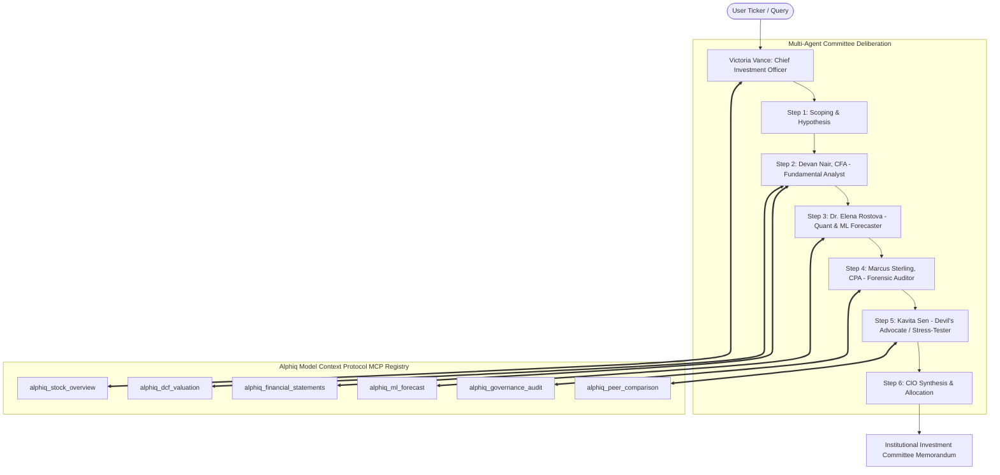

# Alphiq Multi-Agent Investment Committee & Model Context Protocol (MCP) Hub

## 1. Architectural Overview

Alphiq implements a **Production-Grade Multi-Agentic System** designed for institutional equity research. Rather than relying on a single monolithic LLM prompt, Alphiq coordinates **five specialized autonomous agents** that interact with the platform using the **Model Context Protocol (MCP)** specification (`2024-11-05`).



---

## 2. The 5 Investment Committee Personas

| Agent Role | Persona Name | Primary Mandate | Tools Executed |
|---|---|---|---|
| **CIO** | **Victoria Vance** | Orchestrates research hypotheses, balances bull vs bear conflicts, and sets final portfolio sizing. | `alphiq_stock_overview` |
| **FUNDAMENTALIST** | **Devan Nair, CFA** | Audits 10-year financial statements, cash flows, and executes discounted cash flow (DCF) intrinsic equity valuations. | `alphiq_financial_statements`, `alphiq_dcf_valuation` |
| **QUANT_ML** | **Dr. Elena Rostova** | Generates 30/90/180-day ensemble ML price trajectories, volatility regime detection, and Monte Carlo confidence corridors. | `alphiq_ml_forecast` |
| **FORENSIC_AUDITOR** | **Marcus Sterling, CPA** | Audits promoter encumbrance, pledged shareholding, auditor qualifications, and corporate actions. | `alphiq_governance_audit` |
| **DEVILS_ADVOCATE** | **Kavita Sen** | Stress-tests bull theses, challenges high valuations, and quantifies worst-case downside drawdowns. | `alphiq_peer_comparison`, `alphiq_news_sentiment` |

---

## 3. Alphiq Model Context Protocol (MCP) Tools Registry

All platform tools are registered with valid JSON Schemas compliant with the MCP specification:

1. `alphiq_stock_overview`: Live spot prices, market capitalization, P/E ratio, 52-week high/low, exchange info.
2. `alphiq_financial_statements`: 10-year audited revenue, EBITDA, PAT, debt, cash, and free cash flows.
3. `alphiq_ml_forecast`: Machine learning ensemble price forecast with volatility regime classification.
4. `alphiq_dcf_valuation`: Discounted cash flow (DCF) model with configurable WACC and terminal growth rates.
5. `alphiq_governance_audit`: Forensic shareholding audit, promoter pledge percentage, and auditor opinion history.
6. `alphiq_peer_comparison`: Relative multiple comparison (P/E, P/B, EV/EBITDA) against sector competitors.
7. `alphiq_news_sentiment`: Real-time corporate headlines and market sentiment.

---

## 4. External MCP Client Integration

You can integrate Alphiq as a tool provider inside **Claude Desktop**, **Antigravity IDE**, **Cursor**, or custom agent workflows.

### Claude Desktop Configuration
Add the following snippet to `%APPDATA%\Claude\claude_desktop_config.json`:

```json
{
  "mcpServers": {
    "alphiq": {
      "command": "D:\\projects\\stock-analysis-platform\\backend\\venv\\Scripts\\python.exe",
      "args": [
        "D:\\projects\\stock-analysis-platform\\backend\\app\\mcp\\server.py"
      ]
    }
  }
}
```

### HTTP JSON-RPC 2.0 Endpoint
For remote AI frameworks (LangGraph, CrewAI, AutoGen):
- **URL**: `POST http://127.0.0.1:8000/api/v1/mcp/rpc`
- **Supported Methods**:
  - `initialize`
  - `tools/list`
  - `tools/call`
  - `resources/list`
  - `ping`

---

## 5. API Endpoints

- `POST /api/v1/agents/committee/deliberate`: Runs the full 5-agent deliberation on any stock ticker.
- `GET /api/v1/agents/personas`: Returns the roster and mandates of the 5 agents.
- `GET /api/v1/agents/sample-tickers`: Returns curated preset tickers for immediate deliberation.
- `GET /api/v1/mcp/tools`: Lists all registered MCP tools and schemas.
- `POST /api/v1/mcp/tools/{tool_name}/execute`: Executes a tool directly.
- `GET /api/v1/mcp/config`: Returns copy-paste configuration for Claude Desktop and Antigravity IDE.

---

## 6. Regulatory SEBI / RBI Compliance Notice
All agent deliberations, DCF models, and ML projections are strictly for academic, educational, and computational research purposes. Alphiq is not a SEBI-registered Research Analyst or RBI-licensed financial advisor.
